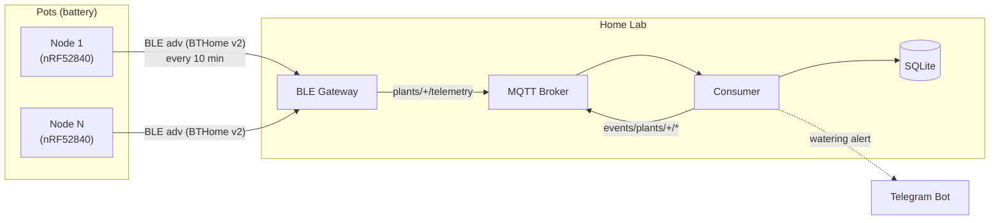

# plants-watcher

Battery-powered soil sensors that live in a plant pot and tell you when — and why — the plant needs water. Each node measures soil moisture, soil temperature and ambient temperature/humidity, and broadcasts them over BLE. A gateway bridges BLE to MQTT, and a Go consumer stores the series, derives the watering decision and alerts over Telegram.

## Status

Planning. No code yet — see the [Roadmap](docs/roadmap.md).

## Architecture



Two design rules drive everything else:

**Nodes are fire-and-forget.** A node never connects to anything. It wakes, measures, broadcasts a BLE advertisement and goes back to sleep. No WiFi credentials, no IP, no association, no broker dependency. A broker outage or a router password change costs nothing — there is no state on the node to invalidate, and nothing to reflash. Because advertisements are broadcast, two gateways hearing the same node give you redundancy for free.

**Nodes do not decide.** They publish raw millivolts. All calibration and watering logic lives in the consumer, so it can be iterated and re-run against history without reflashing eight devices buried in pots.

## Docs

- [Architecture](docs/architecture.md) — topology, node wake cycle, power budget
- [Hardware](docs/hardware.md) — component decisions, BOM and costs
- [MQTT topics](docs/topics_mqtt.md) — the contract between node, gateway and consumer
- [Watering logic](docs/watering_logic.md) — turning millivolts into "water this plant"
- [Roadmap](docs/roadmap.md) — phases and exit criteria

## Planned layout

```
node/       Rust no_std firmware (embassy-nrf + trouble), nRF52840
gateway/    Go — passive BLE scan, BTHome decode, publish to MQTT
consumer/   Go — MQTT to SQLite, watering logic, Telegram alerts
hardware/   KiCad
case/       OpenSCAD
```
