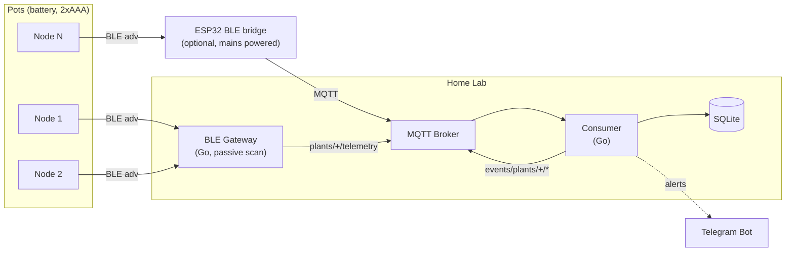
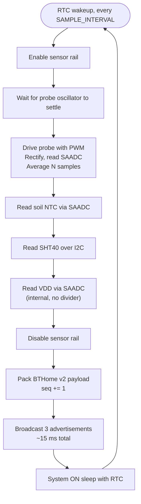
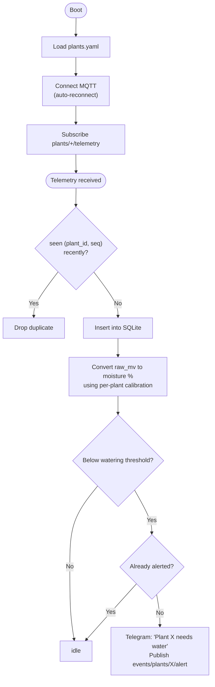

# Architecture

## Topology

The optional ESP32 bridge exists only for coverage. Indoor BLE range through walls is roughly 10-15 m, so a single gateway may not hear every pot. A mains-powered ESP32 placed in a far room decodes the same advertisements and publishes to the same topics — the consumer cannot tell the difference.

## Node — per wake cycle

The node runs the same cycle forever. Nothing persists across cycles except a sequence counter and the sensor warm-up state, both held in retained RAM.

### Why System ON sleep, not System OFF

System OFF on the nRF52840 is ~0.4 uA versus ~1.5-3 uA for System ON with the RTC running. Over five years the difference is under 100 mAh out of a 1000 mAh AAA pair — real, but not decisive.

System ON keeps RAM and the RTC alive, which means the sequence counter and any calibration state survive without touching retention registers, and the Embassy timer just works. The simpler firmware is worth the microamp.

## Gateway

Passive BLE scanning on Linux requires kernel >= 5.10 and BlueZ >= 5.56. Passive means the gateway never sends a scan request, so nodes are never woken or asked to respond — they stay pure broadcasters.

The gateway holds the only piece of per-plant configuration it needs: a mapping from BLE MAC address to `plant_id`. Everything else about a plant lives in the consumer.

Its job is deliberately thin: decode BTHome, stamp `ts` on reception, look up the `plant_id`, publish. No logic, no storage. If it dies, you lose samples but nothing is corrupted.

## Consumer

Deduplication by `(plant_id, seq)` is what makes multiple gateways safe. The same physical advertisement heard by two receivers produces two MQTT messages with the same sequence number; the consumer keeps the first.

The alert latch clears when moisture rises back above the threshold — same pattern as `ALERT_STATE` in mutual-watchdog, just held in the consumer instead of RTC memory.

## Power budget

Per node, at a 10 minute sample interval.

| Item | Current | Duration | Per cycle |
|---|---|---|---|
| Sleep (System ON + RTC) | ~2 uA | 600 s | 0.33 uAh |
| Sensor rail + measurement | ~1 mA | ~50 ms | 0.014 uAh |
| BLE advertising (3x) | ~5 mA | ~15 ms | 0.021 uAh |
| **Total** | | | **~0.37 uAh** |

That is ~0.9 uAh/hour, ~21 uAh/day, dominated almost entirely by sleep current. A 2xAAA alkaline pair (~1000 mAh) gives a theoretical life far beyond the shelf life of the batteries themselves; assume you are limited by self-discharge, not by the node.

The practical consequence: **do not optimise the radio, optimise the sleep current.** Anything left powered — a pull-up on an unused line, the probe oscillator, a leaky FET — costs more than every transmission combined.

For comparison, the same duty cycle over WiFi + MQTT costs roughly 150 uAh per cycle, four orders of magnitude more, which is why the radio choice is what it is. See [hardware](hardware.md#why-not-esp32--wifi).
