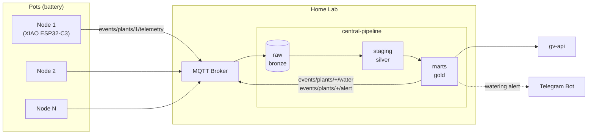
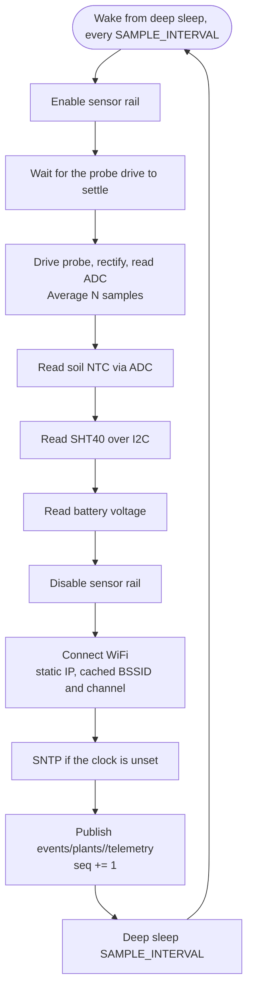

# Architecture

## Topology

plants-watcher is a producer. It ends at the broker: nodes measure and publish, and [central-pipeline](https://github.com/OscarCarPu/central-pipeline) owns ingestion, storage, calibration, watering logic and alerts. There is no resident process in this repo and no local database.

One design rule drives everything else:

**Nodes do not decide.** They publish raw millivolts and nothing more. All calibration and watering logic lives downstream, so it can be changed and re-run against stored history without reflashing devices buried in pots. A node that computed a moisture percentage would freeze a calibration into firmware and make every improvement a flashing job.

## Node — per wake cycle

Phases 0 and 1 run on a XIAO ESP32-C3 that publishes MQTT directly over WiFi. The only state that persists across cycles is the `seq` counter and the cached association parameters, both in RTC memory.

Sensors are read *before* the radio comes up, and the rail is off again before association starts. The two never overlap, so the peak draw the battery has to support is the radio's alone.

Publishing is best-effort. A failed association or a broker that will not answer costs one sample, and the node goes back to sleep rather than retrying — a retry loop turns a network problem into a flat battery, and the gap is visible downstream as a missing `seq` anyway.

## Power budget

Per node, hourly sample interval, on a 1200 mAh LiPo.

| Item | Current | Duration | Per cycle |
|---|---|---|---|
| Deep sleep (XIAO board) | ~45 uA | 3600 s | 45 uAh |
| Sensor rail + measurement | ~1 mA | ~50 ms | 0.014 uAh |
| WiFi associate + publish | ~80 mA | ~2 s | ~45 uAh |
| **Total** | | | **~90 uAh** |

That is ~2.2 mAh/day, or roughly **18 months** on a 1200 mAh LiPo.

The budget splits almost exactly in half between sleeping and talking, which sets the two things worth optimising and the order to do them in:

- **Association, not transmission.** Getting onto the network is the entire radio cost; the publish itself is milliseconds. A static IP with a cached BSSID and channel in RTC memory skips DHCP and the scan, and is the difference between ~2 s and ~6 s awake — roughly 8 months of battery life.
- **Sample interval, not efficiency.** Soil moisture moves over days. Every halving of the interval doubles the association cost for a signal that has not changed. Hourly is already generous; the 10-minute interval that seems natural for telemetry costs six times as much for no extra information.

The 45 uA sleep figure is the XIAO board, not the chip — the battery-sense divider and the QSPI flash. A bare ESP32-C3 module reaches ~6 uA, which alone takes the same node past two and a half years. That is a phase 2 decision, not a phase 1 problem, and it is worth measuring before designing around it.

For contrast, an nRF52840 broadcasting BLE instead of associating costs ~0.02 uAh per cycle against ~45, which is what makes a multi-year alkaline node possible at any interval. The full comparison, and why the radio is not decided yet, is in [hardware](hardware.md#mcu-and-radio--decided-at-phase-2).

## Downstream

Nodes publish `events/plants/<plant_id>/telemetry` and stop there. What happens next — dedup, calibration, thresholds, alerts, history — is central-pipeline's, documented in [MQTT topics](topics_mqtt.md) as a contract and in [watering logic](watering_logic.md) as intent.

The consequence worth internalising: this repo can be entirely rewritten, and the radio swapped, without anything downstream noticing, as long as the same events keep arriving.
